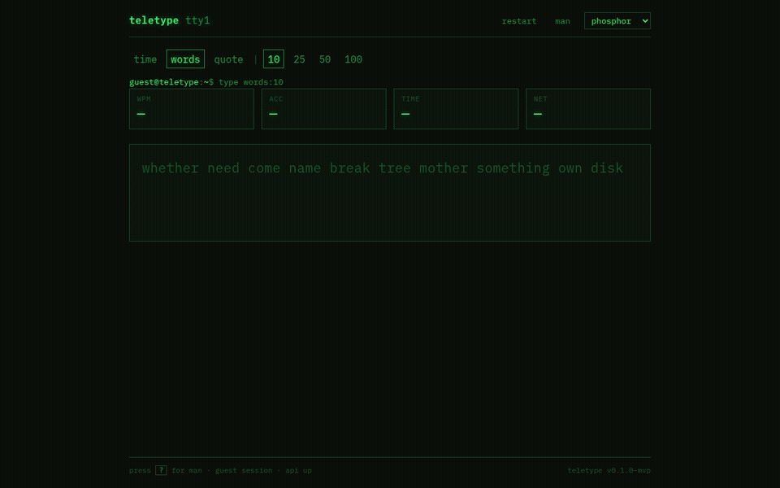
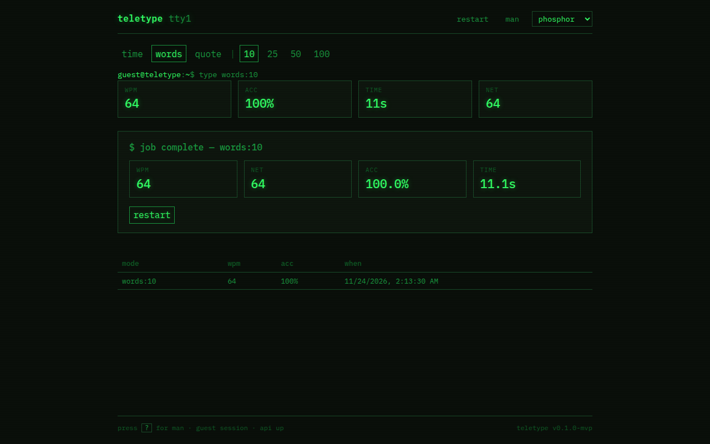

# teletype

[](https://github.com/aneesh-pradhan/teletype/actions/workflows/ci.yml)

teletype is a keyboard-first typing game with a retro terminal look: manpage chrome, phosphor and amber themes, and a prompt line instead of a dashboard.

It is for practicing the same kinds of runs as Monkeytype or TypeRacer without an account. The game loop stays in the browser. Guest results stay in `localStorage`. A small API serves the word list and quotes.

## Demo

A guest **words:10** run on a local `pnpm dev` session (Node.js v22.23.4, pnpm 9.15.0). The prompt came from the API (`whether need come name break tree mother something own disk`). Keystrokes were sent to the running page. The app reported **64 WPM**, **100%** accuracy, **11.1s**, and `api up`. The GIF is sampled from that session, so it plays faster than the 11.1s run.



Still of the same run:



## Prerequisites

Verified with the versions below. CI uses the same Node.js major and the same pnpm version.

| Tool | Version |
|------|---------|
| Node.js | **v22.23.4** (`package.json` `engines` allows `>=20`; CI uses Node.js 22) |
| pnpm | **9.15.0** (pinned by the `packageManager` field; activate it with Corepack) |

Corepack ships with Node.js 22. Docker is not required to play, test, or build. `docker-compose.yml` starts Postgres 16 and Redis 7 for later data-plane work; the current API does not connect to either.

## Setup

From a clean clone:

```bash
git clone https://github.com/aneesh-pradhan/teletype.git
cd teletype
corepack enable
corepack prepare pnpm@9.15.0 --activate
pnpm install --frozen-lockfile
pnpm --filter @teletype/shared build
```

`@teletype/web` and `@teletype/api` import `@teletype/shared` from its build output. `pnpm dev`, `pnpm typecheck`, and `pnpm test` fail until that package has been built once.

## Run

```bash
pnpm dev
```

| Service | URL |
|---------|-----|
| Web | http://localhost:5173 |
| API | http://localhost:8787 |
| Health | http://localhost:8787/health |

Leave `pnpm dev` running and open the web URL. Vite proxies `/api` and `/health` to the API. Stop the process with Ctrl-C.

Play is guest-only: **time** (15/30/60), **words** (10/25/50/100), and **quote**. WPM and accuracy update while you type. Results stay in `localStorage`. Themes are phosphor, amber, VGA, xterm, solarized, and ibm3270. Press `?` for the manpage. Tab then Enter restarts.

## Test

From the repo root, after the setup block above (including the shared build):

```bash
pnpm lint
pnpm typecheck
pnpm test
pnpm build
```

`pnpm lint` runs a package `lint` script when one exists. No package defines one yet, so the command exits 0 without checking files. `pnpm typecheck` is the check that fails on type errors. `pnpm test` runs the typing-engine unit tests (Vitest). `pnpm build` produces `packages/shared/dist`, `apps/api/dist`, and `apps/web/dist`.

These four commands, in this order, are what CI runs after `pnpm install --frozen-lockfile` and `pnpm --filter @teletype/shared build`. The workflow also starts the built API and requests `GET /health`.

## Stack

| Piece | Tech |
|-------|------|
| Web | React 19, Vite, TypeScript |
| API | Hono on Node |
| Shared | `@teletype/shared` domain types |
| Monorepo | pnpm workspaces |
| Tests | Vitest |

## Scripts

| Command | What it does |
|---------|----------------|
| `pnpm dev` | API on :8787 and web on :5173 |
| `pnpm dev:web` / `pnpm dev:api` | One process only |
| `pnpm lint` | Package lint scripts, if any exist |
| `pnpm typecheck` | `tsc --noEmit` in every package |
| `pnpm test` | Unit tests |
| `pnpm build` | Build shared, API, and web |
| `pnpm stack:up` / `pnpm stack:down` | Optional helper: Docker data plane plus the dev servers |
| `pnpm db:up` / `pnpm db:down` | Optional Postgres and Redis only |

## Contributing

Issues, branches, and the pull-request checklist are in [CONTRIBUTING.md](./CONTRIBUTING.md).

## License

[MIT](./LICENSE). Copyright 2026 Aneesh Pradhan.
